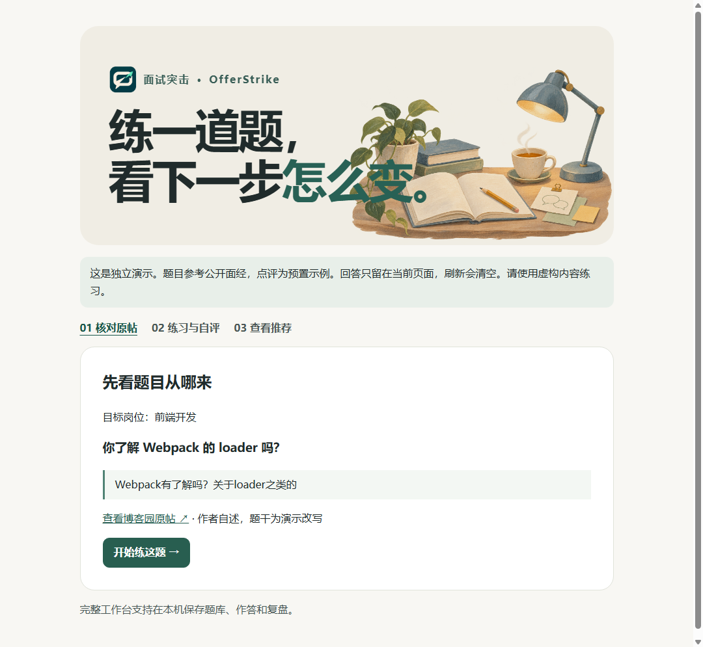

<p align="center">
  
</p>

<h1 align="center">面试突击 · OfferStrike</h1>

<p align="center">
  <strong>别再盲刷题，针对下一场面试出击。</strong>
</p>

<p align="center">
  从面经原帖收题 · 顺着你的回答追问 · 练完知道下一题为什么值得练
</p>

<p align="center">
  <a href="https://vuejs.org/"></a>
  <a href="https://fastapi.tiangolo.com/"></a>
  <a href="https://www.sqlite.org/"></a>
  <a href="https://www.electronjs.org/"></a>
  <a href="LICENSE"></a>
</p>

<p align="center">
  <a href="#两分钟体验">⚡ 两分钟体验</a>　·　
  <a href="#完整安装与启动">🛠 完整安装</a>　·　
  <a href="#核心流程">🗺 核心流程</a>　·　
  <a href="#配置搜索与-ai-服务">🔑 服务配置</a>　·　
  <a href="docs/usage.md">📖 使用文档</a>　·　
  <a href="LICENSE">📄 MIT 许可</a>
</p>

---

> **你收藏夹里的三百篇面经，一篇都不会替你上场。**

明天就面试，今晚打开收藏夹。帖子不少，第一道该练什么？

**把别人面过的题，练成自己答得出的题。** OfferStrike 帮你按目标岗位找公开面经，把核对过的题目放进题库。答完一题，可以接着练追问，也可以打开备战计划，看看下一题为什么值得练。

## 两分钟体验

用 Git 获取源码，安装 **Node.js 22.13+** 后运行。静态体验无需 Python 或 API Key。

```sh
git clone https://github.com/qianmozhuoliunian/offerstrike.git
cd offerstrike
npm run demo:preview
```

打开终端给出的本机地址（默认 `http://127.0.0.1:8090/`）。体验页会用一道改写自公开面经的 Webpack 题带你走完「核对原帖 → 作答和自评 → 查看推荐」。试着切换「需要再练」和「比较熟悉」，看下一题怎么变。点评为预置示例，刷新后本次输入清空。

<p align="center">
  
</p>

## 看一次完整练习

**示例场景** · 明天要面 AI 应用开发，今晚练一道 RAG 排障题。

1. **核对后收题**。按岗位搜索 RAG 面经，打开原帖对照候选题和摘录，确认这道题值得练，再收进题库。
2. **沿着自己的回答练追问**。你答「先调大 top-k，再用重排筛选」。AI 接着问「怎么判断问题出在召回还是生成？如果召回内容已经含有答案，你会先查什么？」
3. **看下一题为什么值得练**。如果你给了召回评估指标，但还没说清怎么排查生成侧，备战计划可以推荐题库里相关的问题，并展示对应的回答依据。题库缺少合适的题时，可以确认后补搜。

## 完整安装与启动

完整工作台需要 **Node.js 22.13+** 和 **Python 3.10+**。

### 1. 安装依赖

首次使用请先按[两分钟体验](#两分钟体验)的前两行命令克隆仓库并进入项目目录。

**Windows PowerShell**

```powershell
npm ci
python -m venv .venv
.venv\Scripts\python.exe -m pip install -r backend/requirements.txt
npm start
```

**macOS / Linux Bash（本机 Web 工作台）**

```bash
npm ci
python3 -m venv .venv
.venv/bin/python -m pip install -r backend/requirements.txt
npm start
```

### 2. 打开工作台

`npm start` 将自动构建 Vue 前端并启动 Python/FastAPI 服务。

复制终端输出的**完整本机链接**到浏览器。链接含本次启动的临时访问凭证，请妥善保管。默认端口为 `8010`，遇到冲突可用 `npm start -- --port 8011`。

### 3. Windows 桌面版

完成 Windows 依赖安装后，可用 `npm run desktop` 启动桌面开发版。Windows x64 安装包可按[桌面版与体验页指南](docs/desktop-and-demo.md)从源码构建。

## 配置搜索与 AI 服务

复制根目录 [.env.example](.env.example) 为 `.env`，按需配置外部能力。修改后重启服务即可生效。

| 准备阶段 / 使用场景 | 对应功能 | 必需配置 |
| :--- | :--- | :--- |
| **本机离线使用** | 手动收题、保存作答、自评、规则推荐、JSON 备份与恢复 | 无需 API Key |
| **公开面经搜索** | 从牛客、掘金、知乎、博客园等来源发现公开面经线索 | 配置 `TAVILY_API_KEY` 或 `EXA_API_KEY` |
| **AI 提题、点评与追问** | 从正文整理候选题、围绕回答追问、解析岗位要求 | 配置 `AI_API_KEY` 和 `AI_MODEL`，按供应商设置 `AI_BASE_URL` |

模型服务需兼容 **OpenAI Chat Completions**，地址填写供应商的基础 URL。真实调用记录见[迁移验收](docs/specs/vue-fastapi-migration.md)，其中使用了 `deepseek-flash`。外部 API 按供应商规则计费。

桌面版在「设置与备份」里单独配置服务，密钥由系统加密保存。网页工作台的 `.env` 请留在本机，并将真实密钥排除在 Git 提交之外。

## 核心流程

**选定岗位 → 搜索面经 → 核对原文收题 → 作答、追问与自评 → 查看下一轮计划**

| 模块 | 功能说明 |
| :--- | :--- |
| **Research · 找题与核对** | 按岗位、公司和时间查找公开面经，从支持来源的正文或手动粘贴的原文里提取候选题，核对摘录后确认入库。 |
| **Interview · 作答与追问** | 围绕同一道题连续练习，最多 8 轮，查看点评和回答依据，也可离线保存作答、自评和恢复草稿。 |
| **Career · 安排下一轮** | 结合岗位要求、题库和练习历史推荐下一步并展示理由。题库不足时创建补搜任务，由用户确认执行。 |

另支持面试复盘、JSON 备份恢复。三题串练和简历能力线索提取为实验功能。

## 边界与隐私

- 自动读取正文目前主要支持**牛客和博客园**的部分文章。搜索结果可能只提供链接，题目摘录、作者自述和公司归属仍需逐项核对。
- AI 点评可能误判，能力判断以多次练习及其回答依据为参考。现有实测结果见[业务质量评估](docs/business-quality-evaluation-2026-11-17.md)。
- 题库、回答和复盘默认保存在本机。SQLite 与导出的 JSON 备份未做整库加密。调用外部搜索或 AI 时，界面披露的内容会发送给已配置的供应商。[数据流向](docs/usage.md#外部服务配置与数据流向)
- 完整工作台面向本机单用户。对外演示请使用独立的静态构建产物 `dist/demo/`。[安全说明](SECURITY.md)

## 文档与参考

- [📖 完整使用与配置指南](docs/usage.md)
- [🏗️ 运行架构与代码结构说明](docs/runtime-architecture.md)
- [🖥️ 桌面客户端与体验页开发](docs/desktop-and-demo.md)
- [🎯 产品设计规范 (DESIGN.md)](DESIGN.md)
- [📋 术语与业务概念表 (GLOSSARY.md)](GLOSSARY.md)
- [🤝 参与贡献与测试指南](CONTRIBUTING.md)
- [🔒 安全策略与报告流程](SECURITY.md)

原创代码采用 [MIT 许可证](LICENSE) 发布。第三方组件与依赖许可参见 [THIRD_PARTY_NOTICES.md](THIRD_PARTY_NOTICES.md)。外部面经内容版权归原作者所有。

遇到找题误判或有练习体验建议，欢迎[提 Issue](https://github.com/qianmozhuoliunian/offerstrike/issues)。如果它帮你练起了收藏夹里的题，也欢迎点个 Star。
