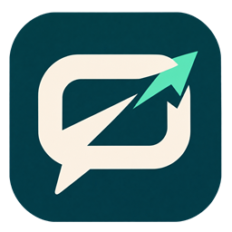

# 面试突击 · OfferStrike

- 中文名：面试突击。国内界面优先展示中文，完整名称为「面试突击 · OfferStrike」。
- 英文名：OfferStrike；包名 `offerstrike`，Windows 文件名使用英文以方便分发。
- 标语：别再盲刷题，针对下一场面试出击。
- 图标：对话框与向上突破的箭头组合，深青色底、米白主体、薄荷绿箭头。

## 图标来源与使用

2026-11-15 使用内置 GPT 图像生成工具（image_gen）生成。未调用外部 CLI 或发送项目私人内容。图标不嵌中文文字；在界面中搭配可访问的中文文本，避免小尺寸文字模糊。



- 原图：`public/assets/offerstrike-original.png`。
- 网页及窗口：`public/assets/offerstrike-icon.png`，256 × 256 PNG。
- Windows 与 favicon：`public/assets/offerstrike.ico`，含 16、32、48、64、128、256 像素尺寸。
- 格式导出：在 Windows PowerShell 运行 `./scripts/build-brand-icons.ps1`。只缩放与导出格式，保留生成图案及透明通道。

图标旁有品牌文字时使用空 `alt`；单独展示图标时给出「面试突击品牌图标」文本替代。名称与图案未做商标检索。

## 兼容标识

`OfferPilot` 旧数据目录、安装器 appId、内部请求头和会话键保留，以便继续读取旧数据并连接现有服务。LICENSE 保留原版权声明。它们不是面向用户的新品牌名。

## 原始生成提示词

```text
Use case: logo-brand. Create ONE production-ready square app icon for a Chinese interview preparation app named 面试突击 / OfferStrike. This is an actual brand symbol to be used in a desktop taskbar, favicon, and small website sidebar, not a presentation mockup. Design a bold, distinctive geometric conversation bubble whose negative space forms a sharp ascending diagonal strike/arrow, suggesting speaking confidently and breaking through an interview. One compact unified silhouette, very few large shapes, readable at 24px. Rich deep teal rounded-square tile (#073F43), with a strong warm ivory symbol and one small vivid mint accent (#65E2BA). Flat vector-like graphic, precise crisp edges, excellent optical balance, professional Chinese technology product identity. Assertive and focused, not military, no weapons. Centered icon fills 85 percent of canvas, even padding. Transparent outside the rounded square tile, full opaque flat colors inside. No text, no letters, no numbers, no Chinese characters inside the icon, no tiny lines, no gradients, no shadows, no 3D, no photo, no brand presentation sheet, no extra variants. Output single square PNG with real alpha.
```
