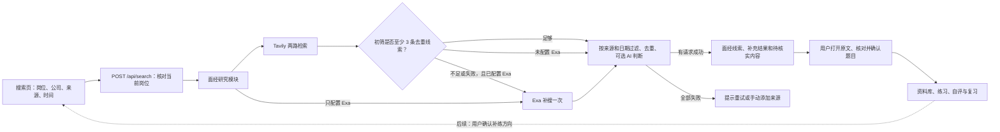

# 从面经检索到求职备战

现有 Web 工作台继续负责岗位、资料库、练习和复习。研究模块只接收一次检索任务并返回候选，题目仍由用户核对原文、确认后进入资料库。

Tavily 和 Exa 都是检索工具，结果是公开网页线索。[Exa Search 接口](https://exa.ai/docs/reference/search)提供发布日期字段；这个日期依然需要回原帖核对。当前模块按规则决定是否补搜，最多 3 次检索请求，AI 只做用户主动开启的相关性判断。后端接口不需要暴露服务商的查询结构，后续可替换工具而无需重做页面。

## 下一步先回答什么

1. **补搜是否有用？** 对照 Tavily 基线，优先比较每次找到的可用原帖数量及质量，再看额外费用和等待时间。若补搜长期找不到额外可用原帖，先替换检索策略或备选服务，不继续叠加 Agent 框架。
2. **能否让用户少做整理？** 对允许读取的公开来源试做原文读取与带证据的候选提题。区分作者明确记录的问题、根据主题整理的问题、AI 生成题；只有原文可定位的摘录才作为证据。失败时保留手动粘贴，题目仍由用户确认。
3. **什么时候需要求职备战 Agent？** 先从用户确认的补练方向回到搜索，验证新材料能否帮用户完成下一轮练习。等到确实需要根据目标和反馈动态安排多个任务，再引入独立的规划循环。复习自评、练习记录、来源及题目维护继续由现有模块负责；简历是否参与由用户另行选择。

## 对比任务与判定

用下表每行的四个组合做 20 个固定任务。同一任务保持岗位、公司、平台与时间范围一致，分别跑 Tavily 基线和双服务；关闭 AI 初筛，人工看每组前 10 条面经线索及实际原帖。

| 目标岗位 | 公司 A | 公司 B | 组合 |
| --- | --- | --- | --- |
| AI 应用开发实习生 | 字节跳动 | 阿里巴巴 | A / 全部 / 近一年；B / 全部 / 近半年；不限公司 / 牛客 / 近三个月；不限公司 / 掘金 / 不限时间 |
| 前端开发实习生 | 腾讯 | 美团 | 同上 |
| 产品经理实习生 | 小红书 | 字节跳动 | 同上 |
| 用户运营实习生 | 哔哩哔哩 | 美团 | 同上 |
| 销售管培生 | 宝洁 | 联合利华 | 同上 |

记录：去重后的可用原帖数、所看原帖数、可打开且有明确面试问题的原帖数、时间和公司误判、请求次数、失败次数、检索耗时和实际计费。可用原帖须能打开、是作者自述、匹配目标及指定公司、符合时间范围。两组都找不到也要保留；标明未知和无法访问，不能靠摘要补齐。先看增量原帖及误判，再决定是否默认启用第二家服务。目前没有两家服务的真实对照结果。
